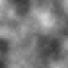
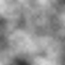
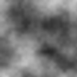
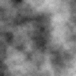
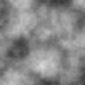

# Лабораторная работа № 1. Подготовка рабочей среды и паспорт воспроизводимого AI-эксперимента

## 1. Вариант 15

[Параметры варианта](configs/params.json)

Контекст: мраморный узор (обложка); 
Фактор: шаг решётки ×2; 

Все значения ниже получены реальным запуском 2026-09-30 14:59:41 UTC в среде: Windows-10-10.0.26200-SP0, CPython 3.11.5. Журнал запуска лежит в reports/.

## 2. Задача и критерий

Задача: Текстура служит фоном обложки с выраженным рисунком: важны богатство деталей и контролируемый контраст. Удвойте шаг решётки (–factor cell) и определите, как укрупнение деталей отражается на метриках и на разбросе между seed.

Гипотеза: Удвоение шага решётки (cell с 24 до 48) изменит граничную энергию и энтропию, 
а средняя яркость и контраст изменятся слабее.

Данные. Синтетические; лицензии не требуются; происхождение — сам генератор lab01_generator.py 
версии 1.0.	

## 3. Параметры

| Параметр | Базовое значение | Значение при факторе |
| :--- | :---: | :---: |
| Размер, пикселей | 96 | 96 |
| Шаг решётки (cell) | 24 | 48 |
| Число октав | 5 | 5 |
| Затухание (persistence) | 0,55 | 0,55 |
| Квантование, бит | 8 | 8 |
| Интерполяция | сглаженная | сглаженная |
| Базовый seed S / число seed n | 101 / 5 | 101 / 5 |

## 4. Команды и результаты

[Паспорт подготовки среды](reports/env_setup.txt). Затем
```bash
python src\\lab01_experiment.py --variant 15 --out ..\\artifacts\\v15
```

### Протокол воспроизводимости (сравнение полных массивов пикселей; SHA-256, первые 16 символов):

| Запуск | seed | sha256 массива (первые 16 символов) |
|---:|---:|---|
| 1 | 101 | `5922bd3272028a64` |
| 2 | 101 | `5922bd3272028a64` |
| 3 | 1101 | `5f5d84203e2d520b` |
| 4 | 101 | `5922bd3272028a64` |

```text
EQ_1_2 = true
EQ_1_4 = true
EQ_1_3 = false
EQ_2_4 = true
```

Отпечаток файла PNG для запусков 1 и 2: совпали — в этой среде, при zlib 1.2.13.

### Разброс и влияние фактора (n = 5, seed 101…105)

Критерий: |Δ| > 2.0·s_base (задан до эксперимента).

| Метрика | среднее (база) | s (база) | среднее (фактор) | Δ | \|Δ\|/s | существенно |
|---|---:|---:|---:|---:|---:|:---:|
| mean | 0.4943 | 0.0134 | 0.5150 | +0.0207 | 1.54 | нет |
| contrast | 0.1162 | 0.0102 | 0.0955 | -0.0207 | 2.04 | да |
| edge | 0.0198 | 0.0005 | 0.0080 | -0.0118 | 21.51 | да |
| entropy | 6.8756 | 0.1224 | 6.5430 | -0.3326 | 2.72 | да |

### Результат первых двух запусков без указания seed

| Первый запуск без seed | Второй запуск без seed |
|:---:|:---:|
|  |  |
| [Результат первого запуска без seed](artifacts/no_seed_1/result_seed1978357804.json) | [Результат второго запуска без seed](artifacts/no_seed_2/result_seed1118058868.json) |

**Вывод**: Без явного указания `seed` генератор будет присваивать случайно-сгенерированный `seed` и в результате сгенерируются два разных отпечатка. Также генератор выдаст типовую ошибку о указании `seed`.

### Резуьтат двух запусков с указанием seed: 101

| Первый запуск с seed:101 | Второй запуск с seed:101 |
|:---:|:---:|
|  |  |
| [Результат первого запуска с seed:101](artifacts/seed1/result_seed101.json) | [Результат второго запуска с seed:101](artifacts/seed2/result_seed101.json) |

Вывод: С явным указанием `seed` будут сгенерированы два одинаковых отпечатка.

### Результат запуска эксперимента

| Первый запуск: seed:101 | Второй запуск: seed:101 | Третий запуск: seed:1101 |  Четвертый запуск: seed: 101 |
|:---:|:---:|:---:|:---:|
|  |  |  |  |

- [Результат генерации изображений](artifacts/v15/results.json)
- [Паспорт эксперимента (.markdown)](artifacts/v15/passport.md)
- [Паспорт эксперимента (.json)](artifacts/v15/passport.json)

**Вывод**: гипотеза подтверждена частично. Удвоение шага решётки существенно изменило граничную энергию (Δ/s = 21.51) и энтропию (Δ/s = 2.72), как и предполагалось. Средняя яркость осталась практически неизменной (Δ/s = 1.54), что также соответствует гипотезе. Однако контраст неожиданно показал существенное изменение (Δ/s = 2.04), хотя ожидалось, что он изменится слабо. Это можно объяснить тем, что при крупном шаге решётки уменьшается число независимых случайных значений в кадре, что влияет на разброс яркости и на контраст.

## 5. Интерпретация

Отношение |Δ|/s по четырём метрикам лежит в пределах от 1.54 до 21.51. Три метрики превысили порог 2, поэтому гипотеза частично подтверждена: граничная энергия и энтропия изменились, средняя яркость слабо изменилась, а контраст существенно изменился.
а средняя яркость и контраст изменятся слабее.

## 6. Ошибка: seed не задан

Симптом: Два запуска одной и той же команды дают разные изображения и разные контрольные суммы. Журнал reports/error.txt: без --seed — отпечатки 3262043de7465fa5bc481b0e21825179f7d7fbdf220fc1aa87118faa420d9ba1 и e792bd49f61b07c55c2ef52de8e2c84373159bbac428c4ee2a6704e91f2abe5e (использованы seed 1978357804 и 1118058868, взятые из системного времени); с --seed 101 — оба раза 93fae5913d79728429ddcdf533063672739fd51e5afa6a7ac243e3e6a80d290b.

Диагностика. (1) Запустить команду дважды и сравнить отпечатки полных данных, а не картинки на глаз. (2) Прочитать предупреждение скрипта. (3) Найти в коде источник случайности: при отсутствии --seed значение берётся из системного времени.

Исправление. Всегда передавать --seed, записывать его в паспорт и использовать локальный random.Random(seed). Ошибка типична и для реальных моделей: пропущенный seed, глобальное состояние, переиспользованное другой библиотекой, параллельные потоки.

## 7. Вывод и ограничения

Вывод: протокол воспроизводимости выполнен полностью (true, true, false, true); Удвоение шага решётки существенно изменило граничную энергию (Δ/s = 21.51) и энтропию (Δ/s = 2.72), как и предполагалось. Средняя яркость осталась практически неизменной (Δ/s = 1.54), что также соответствует гипотезе. Однако контраст неожиданно показал существенное изменение (Δ/s = 2.04), хотя ожидалось, что он изменится слабо.

Ограничения: При крупном шаге в кадр попадает мало независимых значений, и n=5 может оказаться недостаточным для оценки разброса.

## 8. Ссылка на 2 часть по подготовке окружения в Engee

[Паспорт по части Б](reports/passport_b.md)