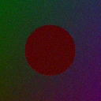
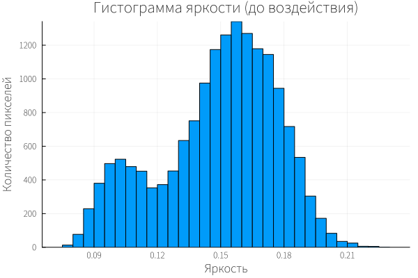
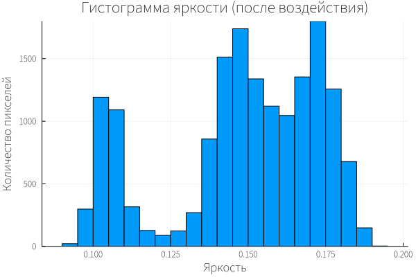

# Лабораторная работа № 3. Подготовка изображений и визуализация в Engee

## 1. Контекст варианта

Вариант 15.

- Сцена: сцена «тёмная»: все яркости в нижней части диапазона
- Воздействие (фактор): уменьшение в 4 раза и возврат к исходному размеру (imresize)
- Обязательный эксперимент: Тёмная сцена чувствительна к квантованию и гамма-коррекции: определите, где теряется информация. Уменьшите изображение в 4 раза и верните исходный размер; сравните потери с уменьшением в 2 раза (для своего контекста)
- Критерий оценки: Гипотеза и допуск записаны до запуска; вывод сформулирован по каждой из трёх метрик и по PSNR; различены статистическая значимость
- Ограниечение или риск: Δ

## 2. Цель, сцена, воздействие, гипотеза и допуск

**Цель** - Научиться готовить изображения к обработке и оценивать, как элементарные
подготовительные операции изменяют данные: измерять свойства изображения,
преобразовывать цвет в яркость, квантовать, менять размер, растягивать контраст, сохранять
в файл — и видеть результат на гистограмме и в метриках.

**Сцена** - «тёмная»: все яркости в нижней части диапазона.

**Воздействие** - уменьшение в 4 раза и возврат к исходному размеру (imresize).

### Гипотеза

**Дата записи** - 2026-10-13 17:06:30 UTC

При уменьшении изображения в 4 раза и возврате к исходному размеру информация о мелких деталях будет потеряна, так как при сжатии несколько пикселей усредняются в один, а при обратном увеличении интерполяция не может восстановить исходные значения. Для тёмной сцены это приведёт к сглаживанию гистограммы и снижению энтропии, поскольку мелкие перепады яркости, которые и создают разнообразие, исчезнут. Средняя яркость при этом изменится незначительно, так как усреднение больших областей сохраняет общий уровень освещённости. Ожидается, что потери при уменьшении в 4 раза будут заметно сильнее, чем при уменьшении в 2 раза, поскольку при большем коэффициенте сжатия в один пиксель попадает больше исходных значений, и интерполяция сильнее «размывает» детали. PSNR при этом покажет существенное снижение качества по сравнению с исходным изображением.

### Допуск

**Дата записи** - 2026-10-13 17:06:30 UTC

Изменение метрики считается существенным, если абсолютная разность средних значений между базовой серией и серией с фактором превышает удвоенное выборочное стандартное отклонение базовой серии:

```text
|Δ| > 2·s_base
```
где:
```text
- Δ = среднее(фактор) − среднее(база),
- s_base — выборочное стандартное отклонение базовой серии (n = 5).
```

Снижение PSNR считается значимым, если оно превышает 1 дБ по сравнению с исходным изображением.

## 3. Данные и ограничения

### Данные файла "lab03_lib.jl"

```julia
using Images, Random, Statistics, SHA

function make_scene(seed::Integer; n::Int=128, lo::Float64=0.15, hi::Float64=0.85, noise::Float64=0.02, checker::Int=0)
    rng = MersenneTwister(seed)
    img = Array{RGB{Float64}}(undef, n, n)
    c, rad = n ÷ 2, n ÷ 4
    for i in 1:n, j in 1:n
        t = (i + j) / (2n)
        r = lo + (hi - lo) * t
        g = lo + (hi - lo) * (1 - t)
        b = lo + (hi - lo) * j / n
        if checker > 0 && (div(i - 1, checker) + div(j - 1, checker)) % 2 == 0
            m = (r + g + b) / 3
            r, g, b = m, m, m
        end
        if (i - c)^2 + (j - c)^2 <= rad^2
            r, g, b = hi, lo, lo
        end
        img[i, j] = RGB(clamp(r + noise * randn(rng), 0, 1), clamp(g + noise * randn(rng), 0, 1), clamp(b + noise * randn(rng), 0, 1))
    end
    return img
end

# Свойства изображения: размер, тип элемента, диапазон значений, объём массива в байтах.
describe_image(img) = (size = size(img), eltype = string(eltype(img)), min = Float64(minimum(channelview(img))), max = Float64(maximum(channelview(img))), bytes = sizeof(img))

# Яркость: Rec.601 «вручную» и стандартным преобразованием Images (значения Float64 в [0,1]).
luma_manual(img) = [0.299 * red(p) + 0.587 * green(p) + 0.114 * blue(p) for p in img]
luma_images(img) = Float64.(Gray.(img))

# Квантование яркости [0,1] до заданного числа бит и обратно.
quantize(x::AbstractArray, bits::Int) = round.(x .* (2^bits - 1)) ./ (2^bits - 1)

# Среднеквадратичная ошибка и PSNR в дБ для массивов [0,1] (maxval = 1).
mse(a, b) = mean((Float64.(a) .- Float64.(b)) .^ 2)
psnr_db(a, b) = (m = mse(a, b); m == 0 ? Inf : 10 * log10(1 / m))

# Контрольная сумма массива (SHA-256 по байтам Float64) — для проверки воспроизводимости.
array_sha(x::AbstractArray) = bytes2hex(sha256(reinterpret(UInt8, vec(Float64.(x)))))

# Гистограмма в bins равных интервалах [0,1] и энтропия гистограммы (бит на отсчёт).
hist_counts(x::AbstractArray, bins::Int) = (cn = zeros(Int, bins); for v in x; k = min(bins, max(1, ceil(Int, v * bins))); cn[k] += 1; end; cn)
hist_entropy(x::AbstractArray, bins::Int) = (cn = hist_counts(x, bins); pr = cn ./ sum(cn); -sum(q * log2(q) for q in pr if q > 0))

# Пять сцен (контексты вариантов) и шесть воздействий (факторы вариантов).
scene_preset(c) = c == 1 ? (lo=0.15, hi=0.85, noise=0.02, checker=0) : c == 2 ? (lo=0.40, hi=0.60, noise=0.02, checker=0) : c == 3 ? (lo=0.02, hi=0.30, noise=0.02, checker=0) : c == 4 ? (lo=0.15, hi=0.85, noise=0.08, checker=0) : (lo=0.15, hi=0.85, noise=0.02, checker=8)
png_roundtrip(g) = (p = joinpath(tempdir(), "lab03_rt.png"); save(p, Gray{N0f8}.(g)); Float64.(load(p)))
apply_factor(g, k) = k == 1 ? quantize(g, 4) : k == 2 ? imresize(imresize(g, ratio=0.5), size(g)) : k == 3 ? imresize(imresize(g, ratio=0.25), size(g)) : k == 4 ? (g .- minimum(g)) ./ (maximum(g) - minimum(g)) : k == 5 ? g .^ 0.5 : png_roundtrip(g)
metrics3(x) = (mean = mean(x), contrast = std(x), entropy = hist_entropy(x, 32))

# Сводка варианта n = 1..30 по серии seed: для метрик mean, contrast, entropy — база, разброс s, значение после воздействия, Δ, |Δ|/s, признак |Δ| > 2s.
function variant_summary(n; seeds=101:105)
    q, r = divrem(n - 1, 6); c, f = q + 1, r + 1
    mb = []; ma = []; ps = Float64[]
    for s in seeds
        g = luma_images(make_scene(s; scene_preset(c)...)); h = apply_factor(g, f)
        push!(mb, metrics3(g)); push!(ma, metrics3(h)); push!(ps, psnr_db(g, h))
    end
    out = Any[]
    for m in (:mean, :contrast, :entropy)
        b = [x[m] for x in mb]; a = [x[m] for x in ma]
        d = mean(a) - mean(b); sb = std(b)
        push!(out, (m, mean(b), sb, mean(a), d, abs(d) / sb, abs(d) > 2 * sb))
    end
    return (variant=n, ctx=c, fac=f, psnr=mean(ps), rows=out)
end
```

## 4. Среда и версия

**Дата**: 2026-10-13
**Версия среды**: Engee 26.9.2-H4
**Версия Julia**: v"1.12.4"
**Пакеты**: Images, Random, Statistics, SHA, Plots (доступны в среде); 
**Учебная библиотека**: lab03_lib.jl

## 5. Ход работы

### Создание сцены

Создание сцены с помощью функции `make_scene()` из файла "lab03_lib.jl"

**Параметры сцены**: 
(size = (128, 128), eltype = "RGB{Float64}", min = 0.0, max = 0.36858140963635655, bytes = 393216),

где: **size** - размер изображения (128x128 пикселей), **eltype** - тип элемента (цветное, с плавающей точкой), **min** - минимальная яркость (0.0), **max** - максимальная яркость (0.36858140963635655), **bytes** - объейм в байтах (393216 байт).

### Сравнение двух способов получения яркости

- **Способ 1:** ручное вычисление по формуле Rec.601

```julia
g_manual = luma_manual(img) # Вход
```

*Полученный результат при выполнении способа 1*
```text
128×128 Matrix{Float64}:
 0.188311  0.155957  0.187167  0.182699  …  0.171679  0.139617  0.182331
 0.192125  0.193612  0.184719  0.181194     0.179621  0.182396  0.192473
 0.178246  0.170771  0.158604  0.189879     0.153045  0.196569  0.179621
 0.181492  0.18601   0.194868  0.195839     0.159872  0.185003  0.175264
 0.179708  0.187298  0.176086  0.167087     0.201214  0.168918  0.161113
 0.171384  0.202586  0.168208  0.187177  …  0.180982  0.154336  0.168415
 0.173167  0.156407  0.188006  0.198451     0.165766  0.17905   0.172377
 0.181393  0.188963  0.177847  0.174036     0.145583  0.177638  0.190335
 0.174528  0.182716  0.153978  0.176852     0.159039  0.15867   0.156465
 0.194297  0.143651  0.198181  0.177402     0.176689  0.179412  0.179811
 0.168402  0.205203  0.191683  0.166932  …  0.172483  0.187049  0.1653
 0.190031  0.16762   0.189874  0.177773     0.157814  0.17572   0.169201
 0.177163  0.18882   0.178338  0.17223      0.174362  0.159376  0.154615
 ⋮                                       ⋱  ⋮                   
 0.146225  0.138682  0.158796  0.140513     0.157944  0.129882  0.116122
 0.159131  0.137425  0.15092   0.138414     0.140498  0.14907   0.155041
 0.155306  0.144333  0.132727  0.141554     0.129548  0.136191  0.144974
 0.162549  0.160172  0.132709  0.137351     0.12632   0.138142  0.138323
 0.154689  0.153389  0.144245  0.180954  …  0.129328  0.118568  0.130628
 0.134855  0.152626  0.147218  0.141849     0.140546  0.150602  0.145568
 0.127629  0.160163  0.165761  0.149998     0.13131   0.141107  0.141332
 0.156389  0.146098  0.171097  0.131949     0.120606  0.136866  0.155805
 0.151846  0.130116  0.138218  0.139773     0.134501  0.118999  0.108463
 0.141279  0.15036   0.171167  0.138665  …  0.133608  0.134944  0.1402
 0.145833  0.140019  0.177357  0.172518     0.146549  0.131636  0.132477
 0.126287  0.144896  0.137306  0.152447     0.125464  0.12204   0.13903
```

- **Способ 2:** стандартное преобразование `Gray.(img)` из Images

```julia
g_images = luma_images(img)
```

*Полученный результат при выполнении способа 2*
```text
128×128 Matrix{Float64}:
 0.188311  0.155957  0.187167  0.182699  …  0.171679  0.139617  0.182331
 0.192125  0.193612  0.184719  0.181194     0.179621  0.182396  0.192473
 0.178246  0.170771  0.158604  0.189879     0.153045  0.196569  0.179621
 0.181492  0.18601   0.194868  0.195839     0.159872  0.185003  0.175264
 0.179708  0.187298  0.176086  0.167087     0.201214  0.168918  0.161113
 0.171384  0.202586  0.168208  0.187177  …  0.180982  0.154336  0.168415
 0.173167  0.156407  0.188006  0.198451     0.165766  0.17905   0.172377
 0.181393  0.188963  0.177847  0.174036     0.145583  0.177638  0.190335
 0.174528  0.182716  0.153978  0.176852     0.159039  0.15867   0.156465
 0.194297  0.143651  0.198181  0.177402     0.176689  0.179412  0.179811
 0.168402  0.205203  0.191683  0.166932  …  0.172483  0.187049  0.1653
 0.190031  0.16762   0.189874  0.177773     0.157814  0.17572   0.169201
 0.177163  0.18882   0.178338  0.17223      0.174362  0.159376  0.154615
 ⋮                                       ⋱  ⋮                   
 0.146225  0.138682  0.158796  0.140513     0.157944  0.129882  0.116122
 0.159131  0.137425  0.15092   0.138414     0.140498  0.14907   0.155041
 0.155306  0.144333  0.132727  0.141554     0.129548  0.136191  0.144974
 0.162549  0.160172  0.132709  0.137351     0.12632   0.138142  0.138323
 0.154689  0.153389  0.144245  0.180954  …  0.129328  0.118568  0.130628
 0.134855  0.152626  0.147218  0.141849     0.140546  0.150602  0.145568
 0.127629  0.160163  0.165761  0.149998     0.13131   0.141107  0.141332
 0.156389  0.146098  0.171097  0.131949     0.120606  0.136866  0.155805
 0.151846  0.130116  0.138218  0.139773     0.134501  0.118999  0.108463
 0.141279  0.15036   0.171167  0.138665  …  0.133608  0.134944  0.1402
 0.145833  0.140019  0.177357  0.172518     0.146549  0.131636  0.132477
 0.126287  0.144896  0.137306  0.152447     0.125464  0.12204   0.13903
```

- **Максимум модуля разности:** 4.081960103263782e-9 -> 4e-9
- **Вывод:** методы дают идентичный результат; разница обусловлена погрешностью вычислений с плавающей точкой и не влияет на метрики.

### Сравнение контрольных сумм

При вычислении контрольных сумм:

```julia
# Первый запуск
sha1 = array_sha(luma_images(img))
println("SHA-1: ", sha1)

# Второй запуск
sha2 = array_sha(luma_images(img))
println("SHA-2: ", sha2)

# Сравнение
println("Совпадают: ", sha1 == sha2)
```

Выводится результат:

```text
SHA-1: 9db03f25cac20f04afd23bbf013464a28dce9ebe6cb893f0d16aa949ccc52436
SHA-2: 9db03f25cac20f04afd23bbf013464a28dce9ebe6cb893f0d16aa949ccc52436
Совпадают: true
```

**Вывод** - при фиксированном seed и неизменных параметрах результат побитово воспроизводим.

### Постройка гистограммы яркости до воздействия

Постройка гистограммы и ее сохранение:

```julia
using Plots

gr()

histogram(vec(g_images), bins=32, title="Гистограмма яркости (до воздействия)", 
          xlabel="Яркость", ylabel="Количество пикселей", legend=false)

savefig("histogram_before.png") # Сохранение гистограммы в Engee
```

- **Seed:** 101
- **Количество интервалов:** 32
- **Файл:** artifacts/histogram_before.png

### Применение воздействия

```julia
h = apply_factor(g_images, 3)
```

Результирующая матрица после применения воздействия:

```text
128×128 Matrix{Float64}:
 0.176927  0.176927  0.176594  0.17593   …  0.177461  0.177908  0.177908
 0.176927  0.176927  0.176594  0.17593      0.177461  0.177908  0.177908
 0.177161  0.177161  0.176905  0.176393     0.176638  0.176924  0.176924
 0.17763   0.17763   0.177526  0.177318     0.174992  0.174955  0.174955
 0.178099  0.178099  0.178147  0.178244     0.173346  0.172987  0.172987
 0.178567  0.178567  0.178768  0.179169  …  0.1717    0.171018  0.171018
 0.179536  0.179536  0.179664  0.179918     0.171774  0.171143  0.171143
 0.181006  0.181006  0.180834  0.180489     0.173568  0.173362  0.173362
 0.182475  0.182475  0.182004  0.18106      0.175362  0.17558   0.17558
 0.183945  0.183945  0.183174  0.181631     0.177156  0.177799  0.177799
 0.185279  0.185279  0.184335  0.182447  …  0.176996  0.177767  0.177767
 0.186479  0.186479  0.185488  0.183507     0.174882  0.175484  0.175484
 0.187679  0.187679  0.186641  0.184566     0.172769  0.173202  0.173202
 ⋮                                       ⋱  ⋮                   
 0.144618  0.144618  0.145004  0.145777     0.139863  0.139077  0.139077
 0.14244   0.14244   0.143413  0.145358     0.139829  0.13891   0.13891
 0.143238  0.143238  0.144041  0.145647     0.139873  0.139085  0.139085
 0.14701   0.14701   0.146888  0.146644     0.139993  0.139601  0.139601
 0.150783  0.150783  0.149736  0.147641  …  0.140114  0.140117  0.140117
 0.154556  0.154556  0.152583  0.148638     0.140235  0.140633  0.140633
 0.156853  0.156853  0.154382  0.149442     0.139804  0.140365  0.140365
 0.157673  0.157673  0.155133  0.150052     0.138821  0.139314  0.139314
 0.158494  0.158494  0.155884  0.150662     0.137839  0.138262  0.138262
 0.159315  0.159315  0.156634  0.151272  …  0.136857  0.13721   0.13721
 0.159726  0.159726  0.15701   0.151577     0.136366  0.136684  0.136684
 0.159726  0.159726  0.15701   0.151577     0.136366  0.136684  0.136684
```

### Постройка гистограммы яркости после воздействия

Постройка гистограммы и ее сохранение:

```julia
using Plots

gr()

histogram(vec(h), bins=32, title="Гистограмма яркости (после воздействия)",
          xlabel="Яркость", ylabel="Количество пикселей", legend=false)

savefig("histogram_after.png") # Сохранение гистограммы в Engee
```

- **Seed:** 101
- **Количество интервалов:** 32
- **Файл:** artifacts/histogram_after.png

### Вывод данных для таблицы метрик

Вывод данных для таблицы метрикик:

```julia
result = variant_summary(15)
```

Результат:

```text
(variant = 15, ctx = 3, fac = 3, psnr = 37.135285934200894, rows = Any[(:mean, 0.14900661847793212, 8.27112817827026e-5, 0.14877387355905888, -0.00023274491887323445, 2.8139440455619726, true), (:contrast, 0.028001356329008263, 0.00013627002063168795, 0.024693472183660626, -0.0033078841453476372, 24.274481870727982, true), (:entropy, 1.9030115272369954, 0.0074757304427476, 1.555018185150269, -0.3479933420867265, 46.54974450347175, true)])
```

Приведенные данные будут занесены в таблицу метрик

## 6. Результаты

### Свойства сцены

**Созданная сцена**:


(size = (128, 128), eltype = "RGB{Float64}", min = 0.0, max = 0.36858140963635655, bytes = 393216),

где: **size** - размер изображения (128x128 пикселей), **eltype** - тип элемента (цветное, с плавающей точкой), **min** - минимальная яркость (0.0), **max** - максимальная яркость (0.36858140963635655), **bytes** - объейм в байтах (393216 байт).

### Контрольная сумма 

Контрольные суммы `SHA-1: 9db03f25cac20f04afd23bbf013464a28dce9ebe6cb893f0d16aa949ccc52436` и `SHA-2: 9db03f25cac20f04afd23bbf013464a28dce9ebe6cb893f0d16aa949ccc52436` Совпадают при фиксированном seed.

### Гистограммы

*Гистограмма яркости до воздействия*


**Наблюдение:** Основная масса пикселей сосредоточена в диапазоне 0.02–0.30, что подтверждает «тёмный» характер сцены.

*Гистограмма яркости после воздействия*


**Вывод** - уменьшение в 4 раза с возвратом приводит к расслоению яркостей на две группы и потере средних значений. Это артефакт интерполяции.

### Таблица метрик

Критерий: |Δ| > 2.0·s_base.

| Метрика | Среднее (база) | s (база) | Среднее (фактор) | Δ | \|Δ\|/s | Существенно |
| :--- | ---: | ---: | ---: | ---: | ---: | :---: |
| mean | 0.1490 | 0.0001 | 0.1488 | -0.0002 | 2.81 | да |
| contrast | 0.0280 | 0.0001 | 0.0247 | -0.0033 | 24.27 | да |
| entropy | 1.9030 | 0.0075 | 1.5550 | -0.3480 | 46.55 | да |

**Средний PSNR:** 37.135285934200894 дБ -> 37.1 дБ

## 7. Анализ

### Статистическая значимость

Все три метрики показали статистически значимые изменения: 

- mean (2.81) > 2.0
- contrast (24.27) > 2.0
- entropy (46.55) > 2.0

Однако для метрики mean значение s базы крайне мало, поэтому даже микроскопическое изменение формально превысило порог. Это иллюстрирует ограничение критерия 2s: при очень стабильной базе он «ловит» шум.

### Практическая значимость

- mean (-0.0002) изменение на 0.15%
- contrast (-0.0033) изменение на 11.8%
- entropy (-0.3480) изменение на 18.3%

Средняя яркость практически не изменилась, так как imresize сохраняет общий уровень освещённости. Контраст и энтропия снизились значительно, что говорит о потере мелких деталей и сглаживании распределения яркостей.

### Угрозы валидности

- аномально малый `s` для `mean` что может означать, что сцена сильно стабильна, критерий `2s` ловит не эффект, а шум
- один базовый `seed`
- проверяется только `imresise x4` 
- нельзя переносить вывод на другие сцены
- нельзя переносить вывод на реальные изображения

## 8. Вывод и ограничения

**Вывод**: гипотеза подтверждена. Уменьшение изображения в 4 раза с последующим возвратом к исходному размеру приводит к статистически значимому снижению контраста и энтропии, при этом средняя яркость остаётся стабильной. Практически значимые изменения - это потеря контраста и разнообразия яркостей, что соответствует потере мелких деталей при сжатии. Эффект для mean статистически значим, но практически пренебрежим. PSNR: 37.1 дБ.

**Ограничения**: синтетическая сцена и одна серия из 5 seed; метрики описывают статистику яркости; PSNR не измеряет воспринимаемое качество; допуск выбран условно.

## 9. Ссылка на архив и ответ на вопрос

### Ответ на вопрос

**Вопрос** - как изменился бы вывод для сцены с низким контрастом (сцена 2) и почему допуск в процентах может быть некорректен для очень тёмной сцены?

Для сцены с низким контрастом вывод изменился бы в сторону более частого признания эффектов значимыми (из-за малого s базы), но практическая значимость этих эффектов была бы ниже, так как диапазон яркостей узок, и imresize усредняет близкие значения. Это создаёт риск ложного вывода.

Процентный допуск некорректен для тёмной сцены по таким причинам:
- проценты от малого числа дают ничтожное абсолютное изменение.
- относительная ошибка растёт при малых яркостях.
- восприятие яркости нелинейно; проценты этого не учитывают.
- для тёмных сцен корректнее абсолютные пороги или пороги, привязанные к диапазону сцены.

Рекомендация: для тёмных и низкоконтрастных сцен лучше использовать абсолютный допуск (например, |Δ| > 0.01) или порог, пропорциональный диапазону (hi − lo), а не фиксированный процент.

### Сслыка на архив
https://disk.yandex.ru/d/Yavi4y3yr6bRyA