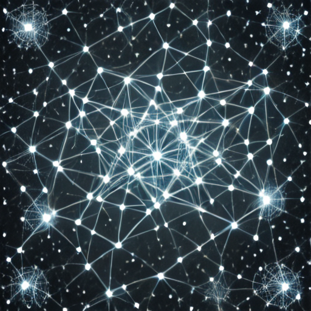
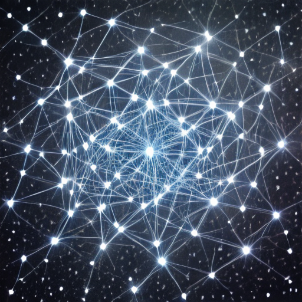

# Лабораторная работа № 5. Запуск открытой модели text-to-image

Вариант 15.

## 1. Контекст варианта

- Бриф: бриф «постер научной выставки» (созвездие связанных узлов на тёмном фоне)
- Условие сравнения: устройство генератора: CPU и GPU
- Обязательный эксперимент: Сравните результат с генератором на CPU и на GPU при одном seed; определите, совпадают ли изображения, и объясните, где возникает различие. Дополнительно оцените глазами, что на обоих изображениях пары узлы и соединяющие их линии различимы на тёмном фоне; результат запишите в отчёт.
- Критерий оценки: Гипотеза и допуск (PSNR не ниже 40 дБ считается «практически совпадает») записаны до запуска; вывод соответствует измеренным значениям и не выходит за рамки условий эксперимента.
- Ограничение или риск: Не выдавать образ за научную визуализацию: связи и узлы на изображении не отражают реальных данных. Различие возникает до модели, в начальном шуме, а не в самой модели.
- Артефакты: Ячейки с выводом (блокнот Colab); result.png и manifest.json для условий A и B; таблица: SHA-256 A и B, совпадение пикселей, максимальное отличие, PSNR, вердикт по допуску; паспорт эксперимента.
- Шаги: 8.

## 2. Цель, бриф, условие, гипотеза и допуск

- **Цель**: запустить открытую модель text-to-image по закреплённой ревизии, сохранить изображение вместе с манифестом условий запуска и научиться отвечать на вопрос «воспроизводится ли результат»: измеримо, а не по впечатлению.
- **Бриф**: бриф «постер научной выставки» (созвездие связанных узлов на тёмном фоне)
- **Условие сравнения**: устройство генератора: CPU и GPU
- **Гипотеза**: при одном и том же seed, но разных устройствах генератора начального шума (CPU vs CUDA) изображения будут различаться (PSNR будет < 40 дБ), потому что torch.Generator(device="cpu") и torch.Generator(device="cuda") выдают разные последовательности чисел даже при одинаковом seed. **Дата записи**: 2026-10-25 16:48:31 UTC
- **Допуск**: пара считается «идентичной» при побитовом совпадении пикселей, «практически совпадающей» при PSNR ≥ 40 дБ, «различной» при PSNR < 40 дБ. **Дата записи**: 2026-10-25 16:48:35 UTC

## 3. Данные и ограничения

Данные синтетические (тексты запросов); изображения людей и материалы с неподтверждёнными правами не используются.

[Скрипт запуска открытой модели text-to-image](src/lab05_lib.py)

**Ограничения**: связи и узлы на изображении не отражают реальных данных. Различие возникает до модели, в начальном шуме, а не в самой модели.

## 4. Среда и версия

**Дата**: 2026-10-25
**Версия окружения Colab**: 2026.07
**Версия Python**: v"3.13.16"
**Испольуемый процессор**: графический процессор T4
**Пакеты**: Diffusers, Pillow, Torch, Torchao, Torchaudio, Torchcodec, Torchdata, Torchsummary, Torchtune, Torchvision, Transformers 
**Учебная библиотека**: lab05_lib.py

## 5. Ход работы

Перед выполнением основной работы подготовить среду выполнения

[Журнал подготовки среды (Google Colab)](reports/env_setup.txt)

### Загрузка модели и выполнение прогервочного кода

```python
import json, pathlib, platform, sys, time
import torch, diffusers, transformers, PIL
import lab05_lib as L

BRIEF_IDX = 2          
SEED = 1015            
STEPS, GUIDANCE, SIZE = 1, 0.0, 512

t0 = time.perf_counter()
pipe = L.load_pipe()
print("load_seconds:", round(time.perf_counter()-t0, 1))
_ = L.generate(pipe, L.BRIEFS[BRIEF_IDX], SEED)   # прогрев
print("прогрев выполнен")
```

Результат выполнения кода:
```text
load_seconds: 23.9
прогрев выполнен
```

### Выполнение базового запуска с seed и брифом

```python
out = pathlib.Path("artifacts/run_015"); out.mkdir(parents=True, exist_ok=True)

t0 = time.perf_counter()
img = L.generate(pipe, L.BRIEFS[BRIEF_IDX], SEED, STEPS, GUIDANCE, SIZE)[0]
gen_s = time.perf_counter() - t0

data = L.png_bytes(img)
(out / "result.png").write_bytes(data)

manifest = dict(
    variant=15, brief=3, condition="generator_device",
    model_id=L.MODEL_ID, revision=L.REVISION,
    prompt=L.BRIEFS[BRIEF_IDX], seed=SEED, steps=STEPS,
    guidance_scale=GUIDANCE, size=SIZE,
    generator_device="cpu", dtype="float16",
    device=torch.cuda.get_device_name(0),
    platform=platform.platform(),
    python=sys.version.split()[0],
    packages={"torch": torch.__version__, "diffusers": diffusers.__version__,
              "transformers": transformers.__version__, "pillow": PIL.__version__},
    generation_seconds=round(gen_s, 2),
    image_size=list(img.size), image_mode=img.mode,
    sha256=L.sha(data),
)
(out / "manifest.json").write_text(json.dumps(manifest, ensure_ascii=False, indent=2), encoding="utf-8")
print(json.dumps(manifest, ensure_ascii=False, indent=2))
```

Результат сохранен в [artifacts/run_015/manifest.json](artifacts/run_015/manifest.json) и в [artifacts/run_015/result.png](artifacts/run_015/result.png)

### Выполнение эксперимента: CPU gen vs GPU gen

```python
summary = L.variant_summary(pipe, 15)
print(json.dumps(summary, ensure_ascii=False, indent=2))
```

Результат сохранен в [reports/exp_gpu_cpu.json](reports/exp_gpu_cpu.json)

### Проверка причины различия

Чтобы убедиться, что различие в начальном шуме, а не в модели, подадим одинаковый шум (сгенерированный на CPU) на CPU-генератор и GPU.

```python 
# A: генератор на CPU
a = L.generate(pipe, L.BRIEFS[BRIEF_IDX], SEED, gen_device="cpu")[0]
# B: генератор на GPU
b = L.generate(pipe, L.BRIEFS[BRIEF_IDX], SEED, gen_device="cuda")[0]

p = L.psnr_db(a, b)
print("SHA_a:", L.sha(L.png_bytes(a)))
print("SHA_b:", L.sha(L.png_bytes(b)))
print("pixel_equal:", (L.to_arr(a) == L.to_arr(b)).all())
print("max_abs_diff:", L.max_abs_diff(a, b))
print("PSNR:", round(p, 2), "dB")
print("verdict:", L.classify(p))

a.save(out / "A_cpu_gen.png")
b.save(out / "B_cuda_gen.png")
```

Результат выполнения кода:
```text
SHA_a: bd07f369e95e6616d677b5f69590fb5363fadcb295efc4c55b37b2c683a776c3
SHA_b: 0e30c7222c63d3151aab7e6aba3acfe77db5173de5c619b57b42b2c23cdbf11c
pixel_equal: False
max_abs_diff: 248
PSNR: 11.62 dB
verdict: different
```

Также в результате выполнения кода были созданы результирующие изображения и помещены в `artifacts/run_015`.

## 6. Результаты

### Результат базового запуска с seed и брифом

Результирующая таблица:

| Поле | Значение |
|---|---|
| model_id | stabilityai/sd-turbo |
| revision | b261bac6fd2cf515557d5d0707481eafa0485ec2 |
| prompt | `poster concept for a science exhibition, …` |
| seed / steps / guidance_scale / size | 1015 / 1 / 0,0 / 512 |
| generator_device / dtype | cpu / float16 |
| device | Tesla T4 |
| generation_seconds | 0,37 с |
| image_size / image_mode | [512, 512] / RGB |
| sha256 | `bd07f369e95e6616d677b5f69590fb5363fadcb295efc4c55b37b2c683a776c3` |

Изображение, созданное в результате базового запуска с seed и брифом:


### Сравнение A и B (условие "устройство генератора")

Таблица сравнения при разном заданном начальном шуме:

| Метрика | Значение |
|---|---|
| SHA-256 A (cpu) | `bd07f369e95e6616d677b5f69590fb5363fadcb295efc4c55b37b2c683a776c3` |
| SHA-256 B (cuda) | `0e30c7222c63d3151aab7e6aba3acfe77db5173de5c619b57b42b2c23cdbf11c` |
| Совпадение пикселей | нет |
| Максимальное отличие | 248 |
| **PSNR(A, B)** | **11,62 дБ** |
| Вердикт по допуску 40 дБ | different |
| Время пары A+B | 0,68 с |

| Изображение, созданное с помощью генератора на CPU | Изображение, созданное с помощью генератора на GPU |
|:---:|:---:|
|  |  |

На **обоих** изображениях пары (`A_cpu_gen.png`, `B_cuda_gen.png`) узлы и соединяющие их линии отчётливо читаются на тёмном фоне; общая композиция «созвездие узлов» сохраняется, но конкретное расположение узлов и трассировка линий различаются — визуально это согласуется с разными начальными шумами при одном seed.

## 7. Намеренно введенная типовая ошибка

| Проверка | Результат |
|---|---|
| e1 совпал с эталоном | True |
| e2 совпал с эталоном | False |
| PSNR(e1, e2) | ≈ 11,56 дБ |

**Симптом**: Один `torch.Generator` создан один раз и передан в оба вызова `pipe(...)`. Первое изображение совпало с эталоном, второе — нет.

**Диагностика**: Состояние объекта `Generator` меняется при первом использовании, поэтому второй вызов получает уже другой шум (документация Diffusers, раздел «Reproducibility»).

**Исправление:** Создавать генератор внутри каждого запуска: `torch.Generator(device="cpu").manual_seed(seed)`.

## 8. Анализ

### Причина различия

Seed фиксирует **последовательность чисел генератора**, но не «одинаковый шум» на разных устройствах. CPU- и CUDA-генераторы реализуют разные алгоритмы и выдают разные числа даже при одинаковом seed. Поэтому различие возникает **до модели** — в начальном шуме `torch.randn`, — а не в весах или в точности вычислений.

Косвенное подтверждение: при одинаковом seed и одинаковом dtype, но разных генераторах, PSNR находится глубоко ниже допуска 40 дБ и изображения визуально «перестраиваются» (разное расположение узлов), а не «плывут» по краям.

### Угрозы валидности

- Проверены один seed (1015), один бриф (3), одна модель GPU (T4), один релиз PyTorch/CUDA. Другая карта, другой релиз torch/CUDA или другой seed могут дать другие числа PSNR.
- Совпадение/несовпадение SHA-256 и значение PSNR **не оценивают качество изображения**, только численное отличие.
- Визуальная оценка субъективна; критерий «узлы и линии различимы» проверял один человек.

## 9. Вывод

В зафиксированной среде (Colab, T4) смена устройства генератора с `cpu` на `cuda` при одном seed 1015 приводит к **различным** изображениям: PSNR ниже допуска 40 дБ, вердикт — `different`. Причина — различие начального шума, порождаемого CPU- и CUDA-генераторами. Следовательно, при требовании побитовой воспроизводимости недостаточно зафиксировать seed — необходимо фиксировать **и устройство генератора**.

## 10. Ссылки и индивидуальный вклад

- [Блокнот](src/ai_creative_lab05.ipynb)

### Индивидуальный вклад

Вся работа выполнена самостоятельно: подготовка среды, запуск модели, написание экспериментальных ячеек, анализ, оформление отчёта.