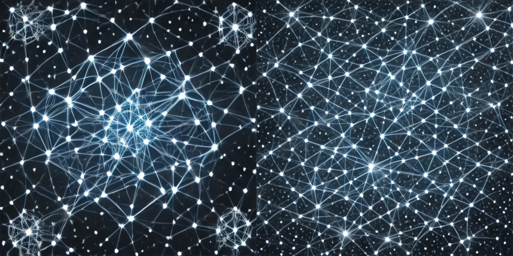

# Лабораторная работа № 5. Запуск открытой модели text-to-image

Вариант 15.

## 1. Контекст варианта

- Бриф: бриф «постер научной выставки» (созвездие связанных узлов на тёмном фоне)
- Фактор: размер кадра: 512 → 768
- Обязательный эксперимент: Увеличьте сторону кадра до 768, то есть выйдите за рекомендованный размер модели: оцените метрики и время и найдите на изображениях признаки выхода за рабочий режим. Дополнительно оцените глазами, что на изображениях узлы и соединяющие их линии различимы на тёмном фоне; результат запишите в отчёт.
- Критерий оценки: Гипотеза и допуск для каждой метрики записаны до запуска; изменён ровно один фактор; вывод отделяет статистическую значимость от практической пользы, а наблюдение – от объяснения.
- Ограничение или риск: Не выдавать образ за научную визуализацию: связи и узлы на изображении не отражают реальных данных. Значение вне рекомендованного размера: артефакты видны на изображениях, а не всегда в метриках.

## 2. Цель, бриф, фактор, гипотеза и допуск

- **Цель**: превратить подбор параметров генерации в контролируемый эксперимент: изменить один фактор, сохранить остальные условия, измерить отклик по нескольким метрикам на серии seed и сформулировать вывод в пределах проверенных условий.
- **Бриф**: бриф «постер научной выставки» (созвездие связанных узлов на тёмном фоне)
- **Условие сравнения**: размер кадра: 512 → 768
- **Гипотеза**: Энергия границ вырастет, но будет больше шума и артефактов вне рекомендованного режима,контраст может измениться слабо или вырасти, CLIP заметно не изменится. Время вырастет пропорционально площади (≈ 2,25×): 768² / 512² ≈ 2.25. Визуально ожидаются артефакты за пределами 512×512: повторяющиеся структуры, «размытие» узлов, нарушения симметрии, ложные линии. **Дата записи**: 2026-10-25 21:22:40 UTC
- **Допуск**: CLIP — ±1,0, энергия границ и контраст — ±10 % от значения в режиме A, время — ±20 %. Критерий статистической значимости: |Δ| > 2s. **Дата записи**: 2026-10-25 21:23:36 UTC

## 3. Данные и ограничения

- **Промпт (бриф 3):** `poster concept for a science exhibition, abstract constellation of connected nodes, dark background with white and cyan lines, balanced composition, no text, no logo`
- **Модель:** `stabilityai/sd-turbo`, ревизия `b261bac6fd2cf515557d5d0707481eafa0485ec2`
- **CLIP:** `openai/clip-vit-base-patch32`, ревизия `3d74acf9a28c67741b2f4f2ea7635f0aaf6f0268`
- **Лицензии:** Stability AI Community License (05.07.2024) — учебное, некоммерческое использование; при распространении сохранять уведомление и «Powered by Stability AI»; CLIP — открытая модель OpenAI, использование для оценки качества допустимо. Изображение **не** выдаётся за научную визуализацию: узлы и линии не отражают реальных данных. В запросе нет реальных людей, логотипов, закрытых материалов.

- [Скрипт запуска открытой модели text-to-image](src/lab05_lib.py)
- [Скрипт исследования параметров text-to-image генерации](src/lab06_lib.py)

**Ограничения**: не выдавать образ за научную визуализацию: связи и узлы на изображении не отражают реальных данных. Значение вне рекомендованного размера: артефакты видны на изображениях, а не всегда в метриках.

## 4. Среда и версия

- **Дата**: 2026-10-25
- **Версия окружения Colab**: 2026.07
- **Версия Python**: v"3.13.16"
- **Испольуемый процессор**: графический процессор T4
- **Пакеты**: Diffusers, Pillow, Torch, Torchao, Torchaudio, Torchcodec, Torchdata, Torchsummary, Torchtune, Torchvision, Transformers 
- **Учебная библиотека**: lab05_lib.py, lab06_lib.py

**Примечание**: Откат diffusers до версии `0.39.0` сделан для обхода ошибки: `cannot import name 'FqnToConfig' from 'torchao.quantization'`.

## 5. Ход работы

Перед выполнением основной работы подготовить среду выполнения

[Журнал подготовки среды (Google Colab)](reports/env_setup.txt)

### Загрузка модели и выполнение прогервочного кода

```python
import lab05_lib as L
import lab06_lib as M
import time

t0 = time.perf_counter()
pipe = L.load_pipe()
print("pipe loaded, s:", round(time.perf_counter()-t0, 1))

t0 = time.perf_counter()
clip = M.load_clip()
print("clip loaded, s:", round(time.perf_counter()-t0, 1))
```

Результат выполнения кода:
```text
clip loaded, s: 8.1
```

### Вывод режимов A и B

```python
N = 15
c, k = (N - 1) // 6, (N - 1) % 6
print("ctx =", c + 1, " factor =", M.FACTORS[k])
a_cfg, b_cfg = M.settings(M.FACTORS[k], c)
print("A:", a_cfg)
print("B:", b_cfg)
```

Результат выполнения кода:
```text
ctx = 3  factor = size_512_to_768
A: {'prompt': 'poster concept for a science exhibition, abstract constellation of connected nodes, dark background with white and cyan lines, balanced composition, no text, no logo', 'steps': 1, 'guidance': 0.0, 'size': 512}
B: {'prompt': 'poster concept for a science exhibition, abstract constellation of connected nodes, dark background with white and cyan lines, balanced composition, no text, no logo', 'steps': 1, 'guidance': 0.0, 'size': 768}
```

### Проведение эксперимента

```python
res = M.variant_summary(pipe, clip, N)

print("Вариант", res["variant"], "| бриф", res["ctx"], "| фактор", res["factor"])
print(f"{'метрика':10s} {'A':>10s} {'s':>10s} {'B':>10s} {'Δ':>10s} {'|Δ|/s':>8s}  |Δ|>2s")
for m, a, s, b, d, ratio, sig in res["rows"]:
    print(f"{m:10s} {a:10.4f} {s:10.4f} {b:10.4f} {d:+10.4f} {ratio:8.2f}  {sig}")
```

Результат эксперимента сохранен в [reports/exp_res.txt](reports/exp_res.txt)

### Построение сравнительного листа для seed:101

```python
from PIL import Image

pair = [
    L.generate(pipe, cfg["prompt"], 101,
               steps=cfg["steps"], guidance=cfg["guidance"], size=cfg["size"])[0]
    for cfg in (a_cfg, b_cfg)
]
pair_resized = [p.resize((512, 512)) for p in pair]

sheet = Image.new("RGB", (1024, 512), (255, 255, 255))
sheet.paste(pair_resized[0], (0, 0))
sheet.paste(pair_resized[1], (512, 0))
sheet.save("comparison.png")
sheet
```

Результат выполнения кода сохранен в [artifacts/](artifacts/comparison.png)

## 6. Результаты

### Вывод режимов A и B

| Режим | Промпт | Шаги | Размер |
|---|---|---|---|
| A | poster concept for a science exhibition, abstract constellation of connected nodes, dark background with white and cyan lines, balanced composition, no text, no logo | 1 | 512 |
| B | poster concept for a science exhibition, abstract constellation of connected nodes, dark background with white and cyan lines, balanced composition, no text, no logo | 1 | 768 |

Задан общий промпт для обоих режимов, одинаковое число шагов и разный размер изображения (для режима A:512x512, для режима B:768x768).

### Таблица метрик (серия seed 101…105)

| Метрика | A (512) | s (A) | B (768) | Δ | \|Δ\|/s | \|Δ\| > 2s |
|---|---|---|---|---|---|---|
| CLIP | 29.8 | 0.55 | 31.2 | +1.38 | 2.53 | True |
| Энергия границ | 0.05 | 0.0025 |  0.051 | -0.0009 | 0.38 | False |
| Контраст | 0.2 | 0.017 | 0.197 | -0.0071 | 0.42 | False |
| Время, с | 0,3026 | 0.0180 | 0.6543 | +0.3517 | 19.59 | True |

### Сравнительный лист для seed:101



Слева — A (512×512, полный размер). Справа — B (768×768, приведён к 512×512 для сопоставимости). Различия: на B заметны:

- Линии стали тоньше, но их стало гораздо больше — сеть превратилась в почти однородную «паутину»;
- Кластеры размылись: там, где слева был один плотный узел, справа — россыпь мелких точек без явного центра;
- Появились артефакты: линии обрываются, «двоятся», в тёмных зонах — заметное количество мелких белых точек-шумов (похоже на «мусор» между узлами);
- Общая композиция плоская: пропала иерархия «главное созвездие — второстепенные», всё выглядит как равномерный текстурированный фон;
- Углы: там, где на A были крупные «спутники», на B — мелкая «рябь».

**Вывод**: B (768) является более шумным, менее структурным, с наличием артефактов.

Добавлены отдельные изображения [512x512](artifacts/A_full_512.png) и [768x768](artifacts/B_full_768.png).

### Классификация по допуску

| Метрика | A | B | Δ, % | \|Δ\|>2s | Допуск | Класс |
|---|---|---|---|---|---|---|
| CLIP | 29.81 | 31.19 | +4.63 % | True | ±1.0 п. | **выше допуска** (+1.38) |
| Энергия границ | 0.0518 | 0.0509 | −1.74 % | False | ±10 % | нейтрально |
| Контраст | 0.2038 | 0.1967 | −3.48 % | False | ±10 % | нейтрально |
| Время | 0.3026 | 0.6543 | +116.2 % | True | ±20 % | **выше допуска** |

## 7. Намеренно введенная ошибка

- guidance 1.0 == guidance 0.0 (SHA-256): True | CFG активен: False
- guidance 3.0: CFG активен: True | PSNR vs guidance 0.0, dB: 12.93

**Симптом.** Ожидалось, что `guidance_scale=1.0` «включает» управление запросом и слегка меняет изображение. Фактически `x1` совпал с `x0` **побитово**, `pipe.do_classifier_free_guidance = False`.

**Диагностика.** В Diffusers CFG включается при `guidance_scale > 1`. SD-Turbo дистиллирована без CFG, значение 0.0 — рекомендованное; 1.0 — «пустое». При `guidance_scale=3.0` `do_classifier_free_guidance = True`, PSNR относительно базового ≈ 12,93 дБ.

**Исправление.** Изучить влияние guidance у этой модели можно только при значениях > 1, то есть вне рекомендованного режима; результат нельзя переносить на модели с обычным CFG.

## 8. Анализ

### Статистическая и практическая значимость

- **Время**: 2s = True и +116 % — оба критерия **выше допуска**.
- **CLIP**: 2s = True и Δ = +1.38 > 1.0 — оба критерия **выше допуска**, но граница близкая (1.38 vs 1.0) при малом s = 0.55; считаем это как **небольшой положительный сдвиг CLIP**, не делающий 768 предпочтительным.
- **Edge / contrast**: 2s = False и |Δ| в пределах ±10 % — оба **нейтральных** критерия.
- **Случая «2s True, допуск не превышен»** в наборе нет. Расхождение могло бы возникнуть для CLIP при чуть большей s — иллюстрация хрупкости порога 2s.

### Угрозы валидности и альтернативные объяснения

- Один бриф, одна модель, пять seed — вывод не переносится на другие модели/брифы.
- Версии библиотек отличаются от эталонных (см. раздел 4) — точные значения могут отличаться от методички; качественный вывод стабилен.
- Метрики размера-зависимы: сравнение A=512 и B=768 без приведения к одному масштабу смещено; в сравнительном листе B приведён к 512.
- Визуальные артефакты 768 **не отражены** в edge/contrast — это ограничение метрик, а не свидетельство «всё в порядке». Визуальная оценка обязательна.
- CLIP оценивает смысловую близость в своём представлении (ViT-B/32, resize до 224×224), а не точность деталей и не эстетику; текст усекается до 77 токенов.
- Время зависит от состояния GPU и не воспроизводится точно между сеансами.

## 9. Вывод

**Время** выросло в 2.16 раза (+116 %) — за пределами допуска ±20 %, статистически значимо (|Δ|/s = 19.59). **CLIP** формально вырос на +1.38 (за пределами ±1.0), но граница близкая; считаем как «небольшой положительный сдвиг в представлении CLIP», а не как улучшение качества. **Энергия границ** (−1.74 %) и **контраст** (−3.48 %) — нейтральны по обоим критериям, но **не выросли**. Гипотеза «768 даст больше деталей» **не подтвердилась**. **Визуально** на 768 присутствуют признаки выхода за рекомендованный режим SD-Turbo (размытие краёв, «двоение» линий, повторяющиеся структуры, шум в тёмных зонах). Метрики edge/contrast этих дефектов **не уловили** — их ограничение.

## 10. Ссылки и индивидуальный вклад

- [Блокнот](src/ai_creative_lab06.ipynb)

### Индивидуальный вклад

Вся работа выполнена самостоятельно: подготовка среды, запуск модели и CLIP, серия из пяти seed,сравнительный лист, классификация по допуску, анализ, оформление отчёта.