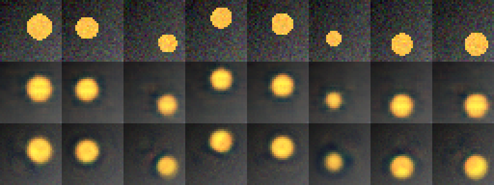

# Лабораторная работа № 7. Исследование параметров text-toimage генерации
Автор: Стукалов А.А.

Вариант 15.

## 1. Контекст варианта

- Набор сцен: набор «диск с шумом»: сцены набора «диск» с гауссовым шумом датчика (σ = 0,05) на каждом изображении
- Фактор: архитектура: свёрточная → полносвязная
- Обязательный эксперимент: Замените свёрточный автокодировщик полносвязным при том же размере латентного вектора: сравните качество, число параметров и время обучения и объясните различие устройством сети. Дополнительно оцените глазами, что на изображениях восстановленные изображения не воспроизводят шум датчика (что автокодировщик выучил, а что отбросил); результат запишите в отчёт.
- Критерий оценки: Гипотеза и допуск записаны до запуска; изменён ровно один фактор; PSNR сопоставлен с эталоном «средняя картинка»; вывод отделяет статистическую значимость от практической пользы, а наблюдение — от объяснения.
- Ограничение или риск: Шум входит в тестовые эталоны: PSNR относительно зашумлённого эталона ограничен уровнем шума и не показывает качество сцены. Разные архитектуры отличаются числом параметров; сравнивайте и качество, и ёмкость.

## 2. Цель, набор, фактор, гипотеза и допуск

- **Цель**: построить автокодировщик на синтетических сценах, измерить качество реконструкции на отложенной выборке и выяснить экспериментом, как на него влияют размер латентного вектора, архитектура, функция потерь, шум на входе и размер обучающей выборки.
- **Набор**: набор «диск с шумом»: сцены набора «диск» с гауссовым шумом датчика (σ = 0,05) на каждом изображении
- **Фактор**: архитектура: свёрточная → полносвязная
- **Гипотеза**: полносвязная сеть на входе 3×32×32 = 3072 числа при d = 8 имеет ≈ 3072×256 + 256×8 ≈ 788 тыс. параметров против ≈ 101 тыс. у свёрточной — она «мощнее», но хуже использует пространственную структуру. PSNR у Dense ниже или равен свёрточной, разрыв train–test больше, время обучения больше. Набор disc_noise содержит шум датчика σ = 0.05 — свёрточная сеть с локальными фильтрами должна лучше его подавлять, чем полносвязная. **Дата выдачи**: 2026-11-04 19:32:30 UTC
- **Допуск**: PSNR +-1дб, разрыв train-test +-0.1дб, время +-20%, число параметров без допуска. **Дата выдачи**: 2026-11-04 19:33:30 UTC

## 3. Данные и ограничения

- **Порождающий код**: `render("disc_noise", f)` в `lab07_lib.py`. Сцена = градиентный фон + янтарный диск с параметрами `cx, cy, r` из трёх факторов `f[0..2] ∈ [0,1]`. Шум датчика σ = 0.05 добавляется к каждому изображению (обучающему и тестовому).
- **Размеры**: 4096 обучающих + 1024 тестовых, 3×32×32.
- **Лицензия**: данные синтетические, внешние источники не используются.

- [Скрипт построения автокодироващика](src/lab07_lib.py)
- [Скрипт демонстрационного варианта](src/lab07_demo.py)

**Ограничения**: шум входит в тестовые эталоны: PSNR относительно зашумлённого эталона ограничен уровнем шума и не показывает качество сцены. Разные архитектуры отличаются числом параметров; сравнивайте и качество, и ёмкость.

## 4. Среда и версия

- **Дата**: 2026-11-04
- **Версия окружения Colab**: 2026.07
- **Версия Python**: v"3.13.16"
- **Испольуемый процессор**: графический процессор T4
- **Пакеты**: torch, numpy
- **Учебная библиотека**: lab07_lib.py, lab07_demo.py

## 5. Ход работы

### Вывод режимов A и B

```python
import lab07_lib as L

N = 15
c, k = (N - 1) // 6, (N - 1) % 6
print("набор:", L.KINDS[c], "| фактор:", L.FACTORS[k])
a_cfg, b_cfg = L.settings(L.FACTORS[k])
print("A:", a_cfg)
print("B:", b_cfg)
```

Результат выполнения кода
```text
набор: disc_noise | фактор: arch_conv_to_dense
A: {'arch': 'conv', 'd': 8, 'loss': 'mse', 'noise': 0.0, 'eval_noise': 0.0, 'n_train': 4096, 'epochs': 20}
B: {'arch': 'dense', 'd': 8, 'loss': 'mse', 'noise': 0.0, 'eval_noise': 0.0, 'n_train': 4096, 'epochs': 20}
```

### Проведение эксперимента

```python
res = L.variant_summary(N)

print("Вариант", res["variant"], "| набор", res["ctx"], "| фактор", res["factor"])
print(f"{'метрика':10s} {'A':>10s} {'s':>10s} {'B':>10s} {'Δ':>10s} {'|Δ|/s':>8s}  |Δ|>2s")
for m, a, s, b, d, ratio, sig in res["rows"]:
    print(f"{m:10s} {a:10.4f} {s:10.4f} {b:10.4f} {d:+10.4f} {ratio:8.2f}  {sig}")
```

Результат эксперимента сохранен в [reports/exp_res.txt](reports/exp_res.txt)

### Вычисление эталона "средняя картинка"

```python
Xtr, Xte, Ftr, Fte = L.dataset(L.KINDS[c])
mean_image = Xtr.mean(0, keepdim=True).expand_as(Xte)
psnr_mean = L.psnr_images(mean_image, Xte)
print("эталон «средняя картинка», PSNR на тесте:", round(psnr_mean, 3), "дБ")
```

Результат выполнения кода
```text
эталон «средняя картинка», PSNR на тесте: 16.763 дБ
```

### Проведение диагностики по размеру d

```python
for d in (1, 2, 3, 4, 8):
    vals = [L.run(L.KINDS[c], dict(L.BASE, d=d), s)[0]["psnr"] for s in (101, 102, 103)]
    print(f"d={d}: PSNR = {np.mean(vals):.2f} dB  (по seed: {', '.join(f'{v:.2f}' for v in vals)})")
```

Результат выполнения кода
```text
d=1: PSNR = 19.64 dB  (по seed: 19.66, 19.71, 19.55)
d=2: PSNR = 21.44 dB  (по seed: 21.43, 21.54, 21.33)
d=3: PSNR = 22.71 dB  (по seed: 22.43, 22.37, 23.34)
d=4: PSNR = 23.17 dB  (по seed: 23.24, 23.16, 23.10)
d=8: PSNR = 23.15 dB  (по seed: 23.35, 23.44, 22.67)
```

### Построение изображения

```python
from PIL import Image
import numpy as np

rows = [Xte[:8]]
for cfg in (a_cfg, b_cfg):
    model = L.run(L.KINDS[c], cfg, 101)[1]
    rows.append(L.reconstruct(model, Xte[:8], cfg["eval_noise"]))

grid = np.concatenate(
    [np.concatenate(list(r.permute(0, 2, 3, 1).cpu().numpy()), axis=1) for r in rows],
    axis=0)
sheet = Image.fromarray((grid * 255).round().astype("uint8")).resize(
    (8 * 32 * 4, 3 * 32 * 4), Image.NEAREST)
sheet.save("comparison.png")
sheet
```

Итоговое изображение находится в [artifacts/comparison.png](artifacts/comparison.png)

### Классификация по допуску

```python
TOL = {"psnr": 1.0, "gap": 0.1, "seconds": 0.20}
def classify(m, a, b):
    if m == "params":
        return "—"
    if m == "seconds":
        rel = (b - a) / a
        return "быстрее" if rel < -TOL[m] else ("медленнее" if rel > TOL[m] else "нейтрально")
    return "лучше" if b - a >  TOL[m] else ("хуже" if b - a < -TOL[m] else "нейтрально")

print(f"{'метрика':10s} {'A':>8s} {'B':>8s} {'Δ':>8s} {'2s':>5s} {'класс':>12s}")
for m, a, s, b, d, ratio, sig in res["rows"]:
    print(f"{m:10s} {a:8.3f} {b:8.3f} {d:+8.3f} {str(sig):>5s} {classify(m,a,b):>12s}")
```

Результат классификации сохранен в [reports/k_res.txt](reports/k_res.txt)

## 6. Результаты

### Таблица метрик (серия seed 101…105)

| Метрика | A (conv) | s (A) | B (dense) | Δ | \|Δ\|/s | \|Δ\| > 2s |
|---|---|---|---|---|---|---|
| PSNR на тесте, дБ | 23.1049 | 0.3092 | 22.8802 | -0.2247 | 0.73 | False |
| Разрыв train–test, дБ | 0.0225 | 0.0059 | 0.1114 | +0.0889 | 15.13 | True |
| Параметры, тыс. | 101.0350 | 0 | 1580.5520 | +1479.5170 | — | True |
| Время обучения, с | 1.7248 | 0.0817 | 1.1171 | -0.6078 | 7.44 | True |

### Эталон «средняя картинка»

**PSNR = 16,763 дБ**.

Выигрыш режимов над эталоном:
- режим A (conv): `PSNR_A − PSNR_mean = 6,3419 дБ`;
- режим B (dense): `PSNR_B − PSNR_mean = 6,1172 дБ`.

### Диагностика по размеру латентного вектора (d = 1, 2, 3, 4, 8)

| d | PSNR (среднее по seed 101–103) |
|---|---|
| 1 | 19.64 |
| 2 | 21.44 |
| 3 | 22.71 |
| 4 | 23.17 |
| 8 | 23.15 |

### Сравнительный лист (`compariosn.png`, seed-101)



На второй строке (сверточная, conv):
- Шум практически полностью подавлен: фон стал гладким.
- Диск восстановлен, но немного размыт — типичное поведение свёрточного AE при MSE-потере.
- Форма круглая, положение и радиус сохранены — по всем 8 сценам визуально корректно.
- Вокруг диска — мягкая «тень»/ореол: сеть сгладила границу.
На третьей строке (полносвязная, dense):
- Шум подавлен хуже: на фоне остаются заметные пятна и «рябь» (особенно в сцене 3 и 7).
- Диск восстановлен, но более «пятнистый»: внутри диска видны неровности яркости, на краях — «зазубрины».
- В некоторых сценах (3, 6, 7) диск выглядит менее чётким, чем у A: контур «плывёт», появляются локальные артефакты.
- Общая композиция сохранена, но качество восстановления ниже.

**Вывод**: визуальная картинка согласуется с гипотезой — свёрточная архитектура лучше использует пространственную локальность (шум — локальный, свёртки его «убирают»), а полносвязная «видит» пиксели независимо и хуже подавляет шум, хотя имеет больше параметров.

## 7. Анализ

### Классификация по допуску

| Метрика | A | B | Δ | \|Δ\|>2s | Допуск | Класс |
|---|---|---|---|---|---|---|
| PSNR | 23.105 | 22.880 | -0.225 | False | ±1.0 дБ | нейтрально |
| Разрыв train–test | 0.023 |  0.111 | +0.089 | True | ±0.1 дБ | нейтрально |
| Время |  1.725 | 1.117 | -0.608 | True | ±20 % | быстрее |
| Параметры | 101.035 | 1580.552 | +1479.517 | True | — | (информационно) |

### Статистическая и практическая значимость

**PSNR.** Δ = −0.225 дБ — и по критерию 2s (False), и по допуску ±1.0 дБ «нейтрально». Оба критерия согласны: **эффекта нет**. Визуально A (conv) выглядит чище (шум подавлен лучше), но PSNR этого не улавливает: при σ = 0.05 вклад шума в MSE невелик, и разница «тонет» в допуске. Это иллюстрирует ограничение PSNR — он не различает «размытие» и «пятнистость».

**Разрыв train–test.** Δ = +0.089 дБ — **расхождение критериев**:
- по 2s (True) изменение статистически значимо (s у A очень мал);
- по допуску ±0.1 дБ — «нейтрально» (0.089 < 0.1), т.е. практически на грани допустимого.

**Время.** Δ = −0.608 с (−35 %) — оба критерия согласны «эффект есть», но **знак неожиданный**: Dense **быстрее** свёрточной, хотя имеет в 15.6 раз больше параметров.

**Вывод**: «больше параметров» ≠ «медленнее» — зависит от типа операций.

**Параметры.** 101.0 тыс. → 1580.6 тыс. (+15.6×). Метрика детерминирована, s = 0, 2s не несёт информации; приводится для оценки ёмкости.

### Угрозы валидности

- **Шум в эталоне**: PSNR ограничен σ = 0.05; сравнение с «средней картинкой» обязательно, но и оно смещено шумом.
- **Разное число параметров**: Dense «мощнее» — часть разницы может объясняться не архитектурой, а ёмкостью. Для строгого сравнения нужно уравнять число параметров.
- **Версии библиотек**: torch +cu130 вместо +cu128 — точные числа могут отличаться, качественный вывод стабилен.
- **5 seed**: разброс может быть небольшим; при малом s критерий 2s «срабатывает» на незначимых практически изменениях.
- **Синтетика**: выводы не переносятся на реальные фотографии.

## 8. Вывод

- **PSNR**: 23.105 → 22.880 дБ (Δ = −0.225, в пределах ±1.0) — «нейтрально» по обоим критериям. Визуально A чище (лучше подавляет шум), но PSNR этого не отражает — ограничение метрики.
- **Разрыв train–test**: 0.023 → 0.111 дБ (Δ = +0.089). 2s=True (статистически значимо), но Δ < 0.1 — **в пределах допуска**, «нейтрально». Dense с 1.58 млн параметров переобучается сильнее, но по выбранному допуску это ещё на грани.
- **Время**: 1.725 → 1.117 с (Δ = −35 %, «быстрее»). Dense **быстрее** вопреки гипотезе: при размере 32×32 свёрточные операции на GPU менее эффективны, чем крупные матричные умножения Dense.
- **Параметры**: 101.0 → 1580.6 тыс. (+15.6×) — ёмкость выросла на порядок.

Свёрточная архитектура лучше использует пространственную локальность, но при выбранном допуске ±1.0 дБ разница в PSNR «нейтральна». Рост параметров в 15.6 раз не дал ни прироста качества, ни замедления — последнее объясняется неэффективностью свёрток на GPU при малом размере входа. Оба режима заметно лучше тривиального эталона «средняя картинка» (PSNR эталона = 16,763 дБ): выигрыш A = 6,3419 дБ, B = 6,1172 дБ.

## 9. Ссылки и индивидуальный вклад

- [Блокнот](src/ai_creative_lab07.ipynb)

### Индивидуальный вклад

Вся работа выполнена самостоятельно: подготовка среды, исправление опечаток Приложения А, запуск серии из пяти seed, диагностика по d, сравнительный лист, анализ, оформление отчёта.