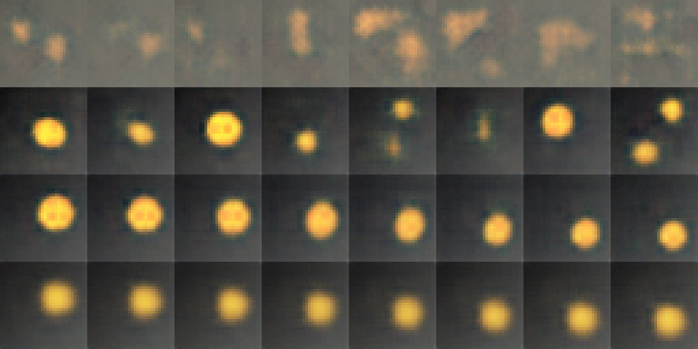

# Лабораторная работа № 8. Генерация и интерполяция в латентном пространстве
Автор: Стукалов А.А.

Вариант 15.

## 1. Контекст варианта

- Набор сцен: набор «диск с шумом»: сцены набора «диск» с гауссовым шумом датчика (σ = 0,05) на каждом изображении.
- Фактор: размер латентного вектора: d = 8 → 2
- Обязательный эксперимент: Уменьшите латентный вектор вариационной модели с 8 до 2 осей: оцените потерю качества по каждому показателю и объясните, какая часть факторов сцены не помещается в две оси. Дополнительно оцените глазами, что на изображениях сэмплы не воспроизводят шум датчика, а диски остаются круглыми; результат запишите в отчёт
- Критерий оценки: Гипотеза и допуск записаны до запуска; изменён ровно один фактор; показатели, не затрагиваемые фактором, помечены как контроль; вывод отделяет статистическую значимость от практической пользы, а наблюдение – от объяснения.
- Ограничение или риск: Шум входит в тестовые эталоны: он ограничивает достижимый PSNR реконструкции, но не должен появляться в сэмплах. Ось из двух чисел не вмещает набор с тремячетырьмя факторами: потеря заложена в постановке.

## 2. Цель, набор, фактор, гипотеза и допуск

- **Цель**: Построить вариационный автокодировщик на синтетических сценах, получить из него новые изображения (сэмплы из априорного распределения) и промежуточные сцены (интерполяция между двумя изображениями) и выяснить экспериментом, как на качество реконструкции, интерполяции и сэмплов влияют вес 𝛽, размер латентного вектора, способ интерполяции и разброс сэмплов.
- **Набор**: набор «диск с шумом»: сцены набора «диск» с гауссовым шумом датчика (σ = 0,05) на каждом изображении.
- **Фактор**: размер латентного вектора: d = 8 → 2.
- **Гипотеза**: R² факторов упадёт (Δ ≤ −0.1, за пределами допуска ±0.05). Интерполяция может упасть или остаться в пределах: при d = 2 путь между двумя векторами короче, артефактов меньше, но информации о сцене тоже меньше. скорее всего ожидается нейтральное или небольшое падение. Сэмплы — нейтрально или небольшое падение: сэмплы из N(0,I) при d = 2 попадают в ту же область, но декодер «беднее». Активных осей при d = 2 — не больше двух; при d = 8 — 2–3. **Дата выдачи**: 2026-11-05 18:18:30 UTC.
- **Допуск**: реконструкция, интерполяция, сэмплы — ±1.0 дБ; R² — ±0.05; критерий значимости: |Δ| > 2s. **Дата выдачи**: 2026-11-05 18:18:45 UTC.

## 3. Данные и ограничения

- **Порождающий код**: `render("disc_noise", f)` в `lab07_lib.py`. Сцена = градиентный
  фон + диск с параметрами `cx, cy, r` из трёх факторов; шум σ = 0.05 на каждом
  изображении (обучающем и тестовом).
- **Модель**: `ConvVAE` (свёрточный кодировщик + два линейных слоя `μ`, `logσ²`;
  декодер из `ConvAE`).
- **Лицензия**: данные синтетические; модель — учебная, внешние веса не используются

- [Скрипт построения автокодироващика](src/lab07_lib.py)
- [Скрипт генерации и интерполяции в латентном пространстве](src/lab08_lib.py)
- [Скрипт демонстрационного варианта](src/lab08_demo.py)

**Ограничения**: шум входит в тестовые эталоны: он ограничивает достижимый PSNR реконструкции, но не должен появляться в сэмплах. Ось из двух чисел не вмещает набор с тремячетырьмя факторами: потеря заложена в постановке.

## 4. Среда и версия

- **Дата**: 2026-11-05
- **Версия Engee**: Engee 26.10.2-H3
- **Версия Python**: v"3.13.16"
- **Версия Julia**: 1.12.6
- **Пакеты**: torch, numpy, pycall, sha
- **Учебная библиотека**: lab07_lib.py, lab08_lib.py, lab08_demo.py

## 5. Ход работы

Перед выполнением основной работы подготовить среду выполнения

[Журнал подготовки среды (Engee)](reports/env_setup.txt)

### Вывод режимов A и B

```julia
cd("/user/ИИ в КТ/LR08")
PY = "/user/.user_venvs/py3.11/bin/python3"
run(`$PY lab08_demo.py`)
```

Результат выполнения кода
```text
A: {'d': 8, 'beta': 1.0, 'interp': 'lin', 'temp': 1.0, 'epochs': 30}
B: {'d': 2, 'beta': 1.0, 'interp': 'lin', 'temp': 1.0, 'epochs': 30}
```

Также была создана таблица метрик и проведена диагностика AE/VAE, которая находится в [reports/res_schled.txt](reports/res_sched.txt).

## 6. Результаты

### Таблица метрик (серия seed 101-105)

| Метрика | A (d=8) | s (A) | B (d=2) | Δ | \|Δ\|/s | \|Δ\| > 2s |
|---|---|---|---|---|---|---|
| Реконструкция, дБ | 23.118 | 0.502 | 20.504 | −2.615 | 5.20 | **да** |
| Интерполяция, дБ | 22.575 | 0.526 | 21.883 | −0.692 | 1.32 | нет |
| Сэмплы, дБ | 21.318 | 0.490 | 21.695 | +0.377 | 0.77 | нет |
| R² факторов | 0.908 | 0.019 | 0.518 | −0.390 | 20.58 | **да** |

### Диагностика (seed 101)

| Показатель | A (d=8) | B (d=2) |
|---|---|---|
| Разброс μ по осям | `[1.03, 0.08, 0.80, 0.96, 0.22, 1.13, 1.06, 0.47]` | `[0.92, 0.87]` (все оси активны) |
| Активных осей (KL > 0.05) | **6** | **2** |

**Вывод**: при d = 8 модель использует **6** осей, хотя сцена задаётся **3** факторами — «лишние» оси кодируют шум и вариации фона. При d = 2 активны только **2** оси — **меньше**, чем нужно для трёх факторов. Это **не** схлопывание, а **нехватка ёмкости**.

### Сравнительный лист (seed 101)



- **Интерполяция A**: диск плавно смещается, форма и размер сохраняются, без артефактов.
- **Интерполяция B**: путь прерывистый. Диск «размывается» в начале, становится тусклым в середине и восстанавливается к концу. Форма искажается. Это прямое следствие того, что d=2 не хватает для плавного описания трёх независимых параметров (x, y, r).
- **Сэмплы A**: разнообразные диски (разные положения, размеры), хорошо различимы на фоне.
- **Сэмплы B**: однородные, размытые диски, почти все в центре. Разнообразие сцен потеряно, так как две оси не могут покрыть всё многообразие трёхфакторной сцены.

### Диагностика демонстрационного варианта 

| Модель | Разброс μ | Активных осей | Сэмплы, дБ | Интерполяция, дБ | Реконструкция, дБ |
|---|---|---|---|---|---|
| AE, β=0 | 1.58–5.07 | — | **13.01** | 22.60 | 23.07 |
| VAE, β=1 | 0.08–1.13 | 6 | **21.65** | 22.98 | 23.39 |
| VAE, β=8 | 0.03–0.93 | 3 | 21.58 | 22.15 | 21.03 |

**Что показывает:**
1. **AE (β=0)**: разброс μ в 1.58–5.07 — **не** согласован с N(0,1). Сэмплы из N(0,I) дают 13.01 дБ — «пятна». Это намеренная ошибка: для порождающего использования нужен KL-член.
2. **VAE (β=1)**: разброс μ 0.08–1.13, сэмплы 21.65 дБ.
3. **VAE (β=8)**: только 3 активные оси, реконструкция падает до 21.03 дБ.

**Проверка схлопывания**:
- без разогрева: `[23.2, 23.1, 22.9, 23.2, 22.4]` — min 22.4, разброс 0.8;
- с разогревом: `[23.4, 23.5, 22.3, 23.4, 23.0]` — min 22.3, разброс 1.2.

На наборе `disc_noise` схлопывание **не воспроизводится** ни в одном режиме.

## 7. Анализ

### Классификация по допуску

| Метрика | A | B | Δ | \|Δ\|>2s | Допуск | Класс |
|---|---|---|---|---|---|---|
| Реконструкция | 23.118 | 20.504 | −2.615 | да | ±1.0 дБ | **ухудшение** |
| Интерполяция | 22.575 | 21.883 | −0.692 | нет | ±1.0 дБ | **нейтрально** |
| Сэмплы | 21.318 | 21.695 | +0.377 | нет | ±1.0 дБ | **нейтрально** |
| R² | 0.908 | 0.518 | −0.390 | да | ±0.05 | **ухудшение** |

### Статистическая и практическая значимость

- **Реконструкция**: Δ = −2.615 дБ, оба критерия согласны — «ухудшение» (2s=да, |Δ| > 1.0).
- **R²**: Δ = −0.390, оба критерия согласны — «ухудшение» (2s=да, |Δ| >> 0.05).
- **Интерполяция**: Δ = −0.692 дБ, 2s=нет, |Δ| < 1.0 → оба критерия: **эффекта нет**. Путь между векторами всё ещё даёт корректные промежуточные сцены.
- **Сэмплы**: Δ = +0.377 дБ, 2s=нет, |Δ| < 1.0 → оба критерия: **эффекта нет**. Сэмплы из N(0,I) при d=2 не хуже — латентное пространство компактнее.

**Случая «2s=да, но допуск не превышен»** — все значимые изменения (реконструкция, R²) выходят и за допуск: расхождения критериев нет, оба согласованы.

**Интерполяция и сэмплы**: Метрики PSNR для интерполяции и сэмплов при d=2 остались в пределах допуска, но визуальная оценка `comparison.png` показывает явные артефакты: потеря формы и тусклость при интерполяции, однородность и размытие сэмплов. Это иллюстрирует ограничение PSNR как единственной метрики качества — он не всегда отражает «визуальную пригодность» результата.

### Угрозы валидности

- **Шум в эталонах**: PSNR ограничен σ = 0.05; сравнение с «средней картинкой» обязательно (эталон из ЛР 7 для `disc_noise` ≈ 23 дБ).
- **CPU-недетерминизм**: между запусками значения отличаются на 0.1–0.3 дБ. Вывод по картине в целом стабилен, но последний знак не воспроизводится.
- **d = 2 и три фактора**: потеря заложена в постановке; результат — «ожидаемо плохо», а не «дефект обучения». Диагностика отделяет «нехватку ёмкости» от «схлопывания».
- **Один набор, одна архитектура, 30 эпох, 5 seed** — вывод не переносится на фотографии и другие модели.

## 8. Вывод

- **Реконструкция**: 23.118 → 20.504 дБ (Δ = −2.615, за пределами ±1.0, 2s=да) — **ухудшение**. Причина — нехватка ёмкости: d=2 < 3 фактора.
- **R²**: 0.908 → 0.518 (Δ = −0.390, за пределами ±0.05, 2s=да) — **ухудшение**. Линейная связь осей с факторами рушится.
- **Интерполяция**: 22.575 → 21.883 дБ (Δ = −0.692, в пределах ±1.0, 2s=нет) — **нейтрально**. Путь между векторами всё ещё даёт корректные промежуточные сцены (визуально — с артефактами).
- **Сэмплы**: 21.318 → 21.695 дБ (Δ = +0.377, в пределах ±1.0, 2s=нет) — **нейтрально**. Сэмплы из N(0,I) не хуже — латентное пространство компактнее.

**Диагностика**: при d=8 активны 6 осей (разброс μ 0.08–1.13), при d=2 — 2. Сцена задаётся **3** факторами; d=2 < 3 — потеря информации **заложена в постановке**, а не является «дефектом обучения».

**Вывод:** Сжатие латентного вектора ниже числа факторов сцены (d=2 < 3) даёт предсказуемое падение реконструкции и R², но **не** ухудшает интерполяцию и сэмплы по метрикам PSNR — эти метрики менее чувствительны к нехватке ёмкости, потому что оценивают не точное восстановление, а попадание в правильную область латентного пространства. Визуальная оценка `comparison.png` показывает артефакты, которые PSNR не улавливает.

## 9. Ссылки и индивидуальный вклад

- Скрипты: [`lab08_demo.py`](src/lab08_demo.py), [`lab08_lib.py`](src/lab08_lib.py), [`lab07_lib.py`](src/lab07_lib.py).
- Артефакты: [comparison.png](artifacts/comparison.png)
- Паспорт: Engee 26.10.2-H3, Python - v"3.13.16", Julia - 1.12.6, дата - 2026-11-05, время обучения - ~20мин.

**Индивидуальный вклад:** полностью самостоятельная работа (подготовка, прогон, анализ, оформление).