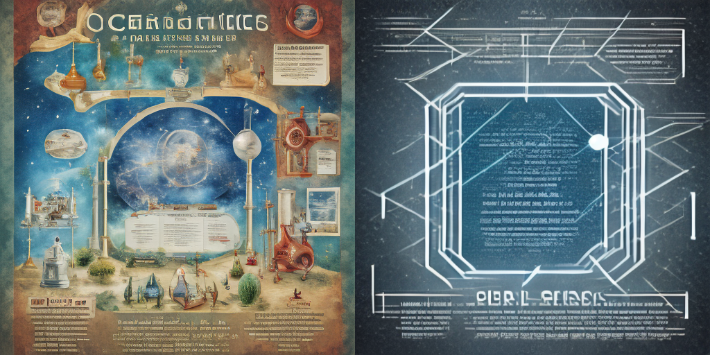

# Лабораторная работа № 9. Промпт-инжиниринг
Автор: Стукалов А.А.

Вариант 15.

## 1. Контекст варианта

- Контекст: контекст «плакат научной выставки»: базовый запрос «science exhibition poster»; описания заказчика — наука (микромир, космос, ДНК, энергетика).
- Добавляемый элемент: фраза о цветовой палитре: «dark background with white and cyan lines»
- Обязательный эксперимент: Часть 1: сравните запрос A «science exhibition poster» и запрос B «science exhibition poster, dark background with white and cyan lines» (пять seed, SD Turbo, 512×512, 1 шаг; главная метрика – сходство с текстом «dark background with white and cyan lines»). Проверьте гипотезу: названия цветов в запросе повышают сходство с фразой о палитре (clip_target); сравните с тем, что видно на изображении. На изображениях отдельно оцените: различимы ли узлы и линии между ними на тёмном фоне. Часть 2: для описаний заказчика вашего контекста (5 описаний в lab09_llm.py) получите JSONописания тремя приёмами – zero-shot, few-shot, пошаговые инструкции – по три повтора в новом чате; проверьте схему (K1), покрытие элементов (K2), точность запретов (K3) и стабильность выбора (K4).
- Критерий оценки: Гипотеза и допуск записаны до запуска; в части 1 изменён ровно один элемент запроса; вывод отделяет статистическую значимость от практической пользы; в части 2 сравнение приёмов опирается на измерения K1–K4 по девяти ответам, а не на впечатление.
- Ограничение или риск: Не выдавать образ за научную визуализацию: связи и узлы на изображении не отражают реальных данных. Цвета в запросе действуют на изображение неравномерно; метрика сходства с фразой не заменяет просмотр изображений.

## 2. Цель, набор, фактор, гипотеза и допуск

- **Цель**: Научиться проверять запрос как гипотезу: в части 1 измерить, как одно добавление к запросу меняет изображение SD Turbo, и отделить эффект от разброса между seed; в части 2 получить от языковой модели структурированное описание сцены тремя приёмами (zero-shot, few-shot, пошаговые инструкции) и сравнить приёмы по проверяемым критериям, а не по впечатлению.
- **Контекст**: контекст «плакат научной выставки»: базовый запрос «science exhibition poster»; описания заказчика — наука (микромир, космос, ДНК, энергетика).
- **Добавляющий элемент**: фраза о цветовой палитре: «dark background with white and cyan lines».
- **Гипотеза**: в 1 части у H1 фраза о палитре повысит clip_target больше, чем на 2s, у H2 clip_subject не упадёт больше допуска, а у H3 edge и contrast изменятся не более чем на 10 %. во 2 части у H4 zero-shot, few-shot и пошаговые инструкции дадут K1 не ниже 0.8, а у H5 few-shot даст наибольшую стабильность K4, пошаговые инструкции — наименьшую. **Дата выдачи**: 2026-11-10 21:20:30 UTC
- **Допуск**: clip_target — 1.0; clip_subject — 1.0; edge и contrast — 10 % от значения A; K1–K4 — без порога. **Дата выдачи**: 2026-11-10 21:20:58 UTC

## 3. Данные и ограничения

- **Запросы:** синтетические, из `lab09_lib.py`.
- **Тексты запросов:** `src/requests/`.
- **Текст-цель CLIP:** `dark background with white and cyan lines`.
- **Модель SD Turbo:** `stabilityai/sd-turbo`, ревизия `b261bac6fd2cf515557d5d0707481eafa0485ec2`. Лицензия Stability AI Community License.
- **CLIP:** `openai/clip-vit-large-patch14`, ревизия `32bd64288804d66eefd0ccbe215aa642df1fc41`.
- **Ограничения:** изображение — концепт, а не научная визуализация; персональные данные в LLM не вводились.

- [Скрипт контролируемого сравнения запросов для SD Turbo](src/lab09_lib.py)
- [Скрипт языковой модели](src/lab09_lim.py)
- [30 вариантов для лабораторной работы](src/run_lr09.py)

## 4. Среда и версия

- **Дата**: 2026-11-10
- **Версия Engee**: Engee 26.10.2-H3
- **Версия Python**: v"3.13.16"
- **Версия Julia**: 1.12.6
- **Пакеты**: torch, numpy, scipy, diffusers, transformers
- **Учебная библиотека**: lab09_lib.py, lab09_lim.py, run_lr09.py

## 5. Ход работы

Перед выполнением основной работы подготовить среду выполнения

[Журнал подготовки среды (Engee)](reports/env_setup.txt)

В результате подготовки среды созданы два документа: [err9_15.txt](reports/err9_15.txt) и [out9_15.txt](reports/out9_15.txt).

### Построение двух изображений A и B

```julia
cd("/user/ИИ в КТ/LR09")  # ваша папка
PY = "/user/.user_venvs/py3.11/bin/python3"
run(`$PY -c "
import lab09_lib as L
pipe = L.load_pipe()
a = L.generate(pipe, L.prompt_a(2), 101)
b = L.generate(pipe, L.prompt_b(2, 2), 101)
a.save('A_seed101.png')
b.save('B_seed101.png')
# сравнение
from PIL import Image
w, h = a.size
sheet = Image.new('RGB', (2*w, h))
sheet.paste(a, (0, 0)); sheet.paste(b, (w, 0))
sheet.save('comparison_variant15.png')
print('saved')
"`)
```

Результат выполнения кода: создание трех изображений: [изображение A](artifacts/A_seed101.png), [изображение B](artifacts/B_seed101.png) и [сравнительное изображение](artifacts/comparison_variant15.png).

### Запросы к языковой модели

```julia
run(`$PY lab09_llm.py prompt zero 3`)
run(`$PY lab09_llm.py prompt few 3`)
run(`$PY lab09_llm.py prompt step 3`)
```

Результат выыполнения кода: три текста каждого приема (zero, step, few).

### Оценка ответов языковой модели

Оценим каждый ответ с помощью функции `stability`:

```julia
run(`$PY lab09_llm.py score answers/ctx3_zero_r1.txt 3`)
run(`$PY lab09_llm.py score answers/ctx3_zero_r2.txt 3`)
run(`$PY lab09_llm.py score answers/ctx3_zero_r3.txt 3`)
run(`$PY lab09_llm.py score answers/ctx3_few_r1.txt 3`)
run(`$PY lab09_llm.py score answers/ctx3_few_r2.txt 3`)
run(`$PY lab09_llm.py score answers/ctx3_few_r3.txt 3`)
run(`$PY lab09_llm.py score answers/ctx3_step_r1.txt 3`)
run(`$PY lab09_llm.py score answers/ctx3_step_r2.txt 3`)
run(`$PY lab09_llm.py score answers/ctx3_step_r3.txt 3`)
```

Затем запустим сводку K1-K4 для каждого приема:

```julia
run(`$PY -c "
import glob, lab09_llm as M
files = sorted(glob.glob('answers/ctx3_zero_*.txt'))
print('Файлов:', len(files))
print('K4 (общая):', M.stability(files))
"`)
run(`$PY -c "
import glob, lab09_llm as M
files = sorted(glob.glob('answers/ctx3_few_*.txt'))
print('Файлов:', len(files))
print('K4 (общая):', M.stability(files))
"`)
run(`$PY -c "
import glob, lab09_llm as M
files = sorted(glob.glob('answers/ctx3_step_*.txt'))
print('Файлов:', len(files))
print('K4 (общая):', M.stability(files))
"`)
```

В результате выполнения кода будет создано 9 словарей (3 приема x 3 повтора).

[9 словарей и сводка K1-K4](reports/rep_zero_step_few.txt)

## 6. Результаты

### Таблица метрик (серия seed 101-105)

| Метрика | A (базовый) | s (A) | B (с палитрой) | Δ | \|Δ\|/s | \|Δ\| > 2s |
|---|---|---|---|---|---|---|
| clip_target | 10.441 | 0.677 | 18.686 | +8.244 | 12.18 | да |
| clip_subject | 23.751 | 0.519 | 18.601 | −5.150 | 9.92 | да |
| edge	0.0362 | 0.0018 | 0.0538 | +0.0177 | 9.85 | да |
| contrast | 0.1438 | 0.0137 | 0.1911 | +0.0474 | 3.46 | да | 

### Сравнительный лист (A и B изрбражения, seed 101)



- **Изображение A** — сложная, насыщенная деталями иллюстрация в стиле старинной гравюры. Множество объектов (сферы, приборы, растения), тёплые тона, псевдотекст. Хорошо соответствует «плакату научной выставки».
- **Изображение B** — минималистичный футуристичный чертёж. В центре — сфера в обрамлении строгих линий, **тёмный фон** и **белые/голубые линии**. Текста меньше, он стилизован под технические надписи. Пустого пространства больше.

**Связь с метриками:**
- Рост `clip_target` (+8.24) объясняется тем, что B **буквально** реализует фразу «dark background with white and cyan lines», а A — нет.
- Падение `clip_subject` (−5.15): B выглядит как «технический чертёж», а не как «плакат выставки» с множеством объектов.
- Рост `edge` (+48.8 %) и `contrast` (+32.9 %) согласуется с визуальным впечатлением: B резче и контрастнее за счёт ярких линий на тёмном фоне.

### Сводка K1-K4

Perplexity, 10.11.2026; контекст 1; по 3 повтора в новом чате на каждый прием.
Ответы лежат в папке `answers/`.

| Приём | K1 | K2 | K3 | K4 |
| zero-shot | 1.00 | 1.00 | 1.00 | 0.800 |
| few-shot | 1.00 | 1.00 | 1.00 | 0.867 |
| пошаговые инструкции | 1.00 | 1.00 | 1.00 | 0.933 |

K1–K3 у всех приёмов равны 1,0 (потолок), различаются только стабильности выбора.
K4 по всем 9 файлам (общая) = 0.828

## 7. Анализ

### Классификация по отклику

| Метрика | A | B | Δ | \|Δ\|>2s | Допуск | Класс |
| clip_target | 10.441 | 18.686 | +8.244 | да | ±1.0 п. | улучшение |
| clip_subject | 23.751 | 18.601 | −5.150 | да | ±1.0 п. | ухудшение |
| edge | 0.0362 | 0.0538 | +0.0177 | да | ±10 % | выше допуска (+48.8 %) |
| contrast | 0.1438 | 0.1911 | +0.0474 | да | ±10 % | выше допуска (+32.9 %) |

Добавление палитры сильно улучшило соответствие целевой фразе (+78.9 %), но при этом сильно увели от предмета (−21.7 %).

### Интерпретация метрик

**`clip_target` (+8.24, |Δ|/s = 12.18).** Фраза о палитре дала сильный и статистически значимый рост сходства с целевым текстом «dark background with white and cyan lines». Это **лучший результат** среди элементов запроса (средний Δ у палитры — +7.56). Гипотеза H1 подтверждена: эффект не только превышает 2s, но и в разы больше допуска ±1.0.

**`clip_subject` (−5.15, |Δ|/s = 9.92).** Сходство с базовым предметом («science exhibition poster») упало на 21.7%. Это **значимое ухудшение** — добавление палитры «увело» изображение от исходного предмета. Гипотеза H2 **не подтверждена**.

**`edge` (+48.8 %).** Энергия границ выросла почти в полтора раза. Изображение стало резче и детальнее — вероятно, из-за контраста «тёмный фон — светлые линии». Гипотеза H3 («edge в пределах ±10 %») **не подтверждена**.

**`contrast` (+32.9 %).** Контраст вырос, что логично для фразы «dark background with white and cyan lines»: тёмный фон и светлые линии создают высокий перепад яркости.

### Интерпретация K1-K4

**K1–K3 = 1.0 у всех приёмов.**. Для сильной модели zero-shot, few-shot и пошаговые инструкции дают одинаково корректные ответы.

Полученные значения:

- **few-shot = 0.867** — вторая по стабильности;
- **пошаговые инструкции = 0.933** — **самая высокая**;
- **zero-shot = 0.800** — **самая низкая**.

**Гипотеза H5** («few-shot даст наибольшую K4, пошаговые инструкции — наименьшую») **не подтверждена**: результат **обратный** ожидаемому.

**Возможное объяснение.** В пошаговом приёме модель сначала выписывает описания, а затем выбирает `style` и `composition` из закрытого списка — это дисциплинирует выбор и делает его более стабильным между повторами. Few-shot даёт примеры, но модель всё равно выбирает свободнее. Zero-shot — самый свободный выбор, поэтому самый нестабильный.

### Статистическая и практическая значимость

- **`clip_target`**: и 2s = True, и Δ > допуска — «улучшение».
- **`clip_subject`**: и 2s = True, и Δ > допуска — «ухудшение». Это **компромисс**: улучшая соответствие целевой фразе, мы теряем предмет.
- **`edge`, `contrast`**: и 2s = True, и Δ > 10 % — «выше допуска».

**Случая «2s = True, но допуск не превышен»** в данных нет. Однако такой случай мог бы возникнуть при меньшем Δ и малом s — как в демонстрационном варианте, где `clip_target` вырос на +4.61, но |Δ|/s = 1.6 < 2.

**Расхождение метрики и глаза.**
- Рост `clip_target` (+8.24) объясняется тем, что B **буквально** реализует фразу «dark background with white and cyan lines», а A — нет.
- Падение `clip_subject` (−5.15) видно глазами: B выглядит как «технический чертёж», а не как «плакат выставки» с множеством объектов.
- Рост `edge` (+48.8 %) и `contrast` (+32.9 %) согласуется с визуальным впечатлением: B резче и контрастнее за счёт ярких линий на тёмном фоне.

## 8. Вывод

**Часть 1.**

Добавление фразы о палитре дало мощный эффект: clip_target вырос на +8.24 (почти в 2 раза), и визуально B действительно стал тёмным с голубыми линиями. Но это "увело" изображение от предмета: clip_subject упал на −5.15, и B теперь больше похож на технический чертёж, чем на плакат выставки. Фраза о палитре сильно улучшает соответствие целевой фразе, но может "перетянуть" внимание модели от предмета.

**Часть 2.**

**Ключевой тезис.** Для сильной языковой модели приёмы **не различаются по корректности**; различие видно только в **воспроизводимости** (K4). Пошаговые инструкции дают более стабильный выбор `style` и `composition`, чем few-shot и zero-shot, — но это вывод на малой выборке, требующий подтверждения.

## 9. Ссылки и индивидуальный вклад

- **Артефакты:** [`comparison_variant15.png`](artifacts/comparison_variant15.png), [`A_seed101.png`](artifacts/A_seed101.png), [`B_seed101.png`](artifacts/B_seed101.png), [`out9_15.txt`](reports/out9_15.txt).
- **Ответы LLM:** `answers/ctx3_{zero,few,step}_r{1,2,3}.txt` (9 файлов, без правок).
- **Индивидуальный вклад:** полностью самостоятельная работа.